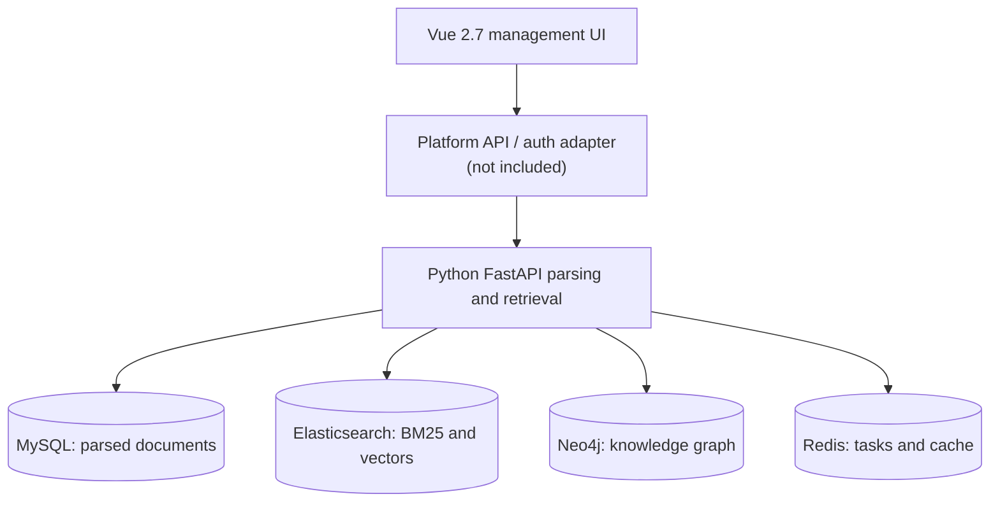
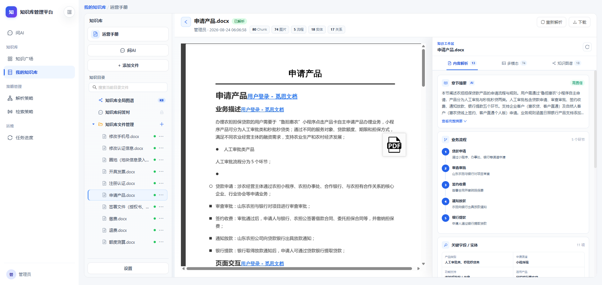
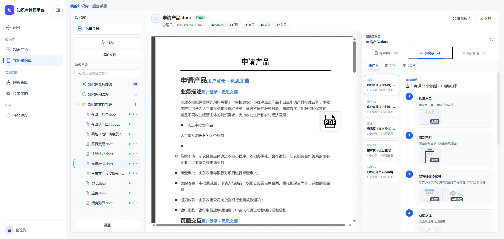
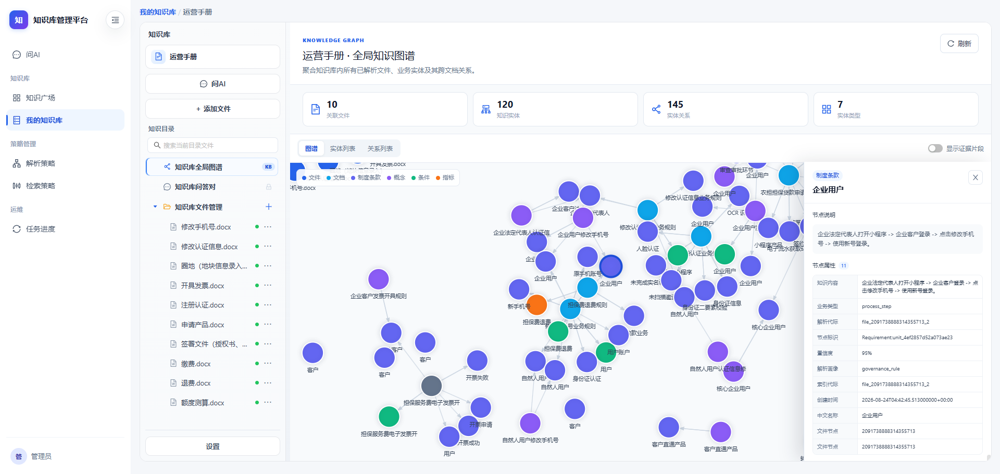
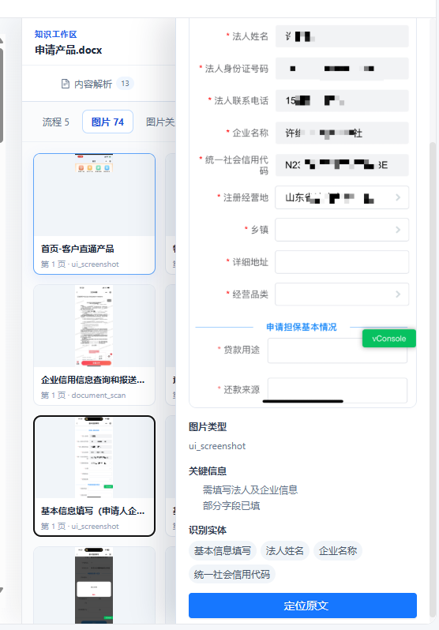

<div align="center">

# Enterprise Knowledge RAG

### Multimodal Document Understanding · GraphRAG · Hybrid Search · Evidence-grounded Q&A

**A Python-based knowledge retrieval engine with a Vue management interface, designed for structured documents, knowledge graphs, and traceable evidence.**

[简体中文](README.zh-CN.md) · [Algorithm map](docs/ALGORITHMS.md) · [Reproducibility](docs/REPRODUCIBILITY.md) · [Integration](docs/INTEGRATION.md)


</div>

> **Status:** This is an engineering source snapshot, **not yet a one-command standalone demo**. The Python services rely on external storage, OCR/model endpoints and a file center; the Vue interface currently requires a separate platform API/authentication adapter. The original organization-specific Java service has been removed from the proposed public source tree because redistribution rights are not available. See [reproducibility notes](docs/REPRODUCIBILITY.md).

## Why this project?

Enterprise retrieval is more than *PDF → embeddings → chatbot*. Documents contain headings, tables, diagrams, entities, policies, and claims that users must verify against original sources.

This project explores a richer RAG pipeline:

1. **Parse:** layout-aware OCR and vision-language OCR backends for PDF/image documents.
2. **Structure:** catalog, AST, and container-aware chunking with source references.
3. **Connect:** entity extraction, deduplication, and knowledge graph construction.
4. **Retrieve:** query-aware selection across lexical, vector, structured, QA, summary and graph channels.
5. **Ground:** align evidence quotations to source spans and preserve image references.

## Algorithm and engineering highlights

| Area | What is implemented | Source |
| --- | --- | --- |
| Multimodal parsing | Paddle layout or compatible VLM OCR; document normalization and image evidence | [Parser](python-service/src/danbao_poc/document_parser.py), [multimodal](python-service/src/danbao_poc/multimodal.py) |
| Structure-aware chunking | Catalog, AST and container methods; protected table/code regions | [AST chunker](python-service/src/danbao_poc/ast_chunker.py), [catalog chunker](python-service/src/danbao_poc/catalog_chunker.py) |
| Knowledge graphs | Entities, relations, deduplication candidates, graph communities and Neo4j indexing | [Anchor deduper](python-service/src/danbao_poc/anchor_deduper.py), [communities](python-service/src/danbao_poc/graph_community.py) |
| Hybrid retrieval | QA, structured, section summary, graph, BM25 and vector channels with query-aware planning | [Retrieval plan](python-service/src/danbao_poc/retrieval_plan.py), [query](python-service/src/danbao_poc/query.py) |
| Evidence alignment | Exact, normalized, and LCS-based quote matching with coverage/density checks | [Evidence aligner](python-service/src/danbao_poc/evidence_aligner.py) |
| Management UI | Knowledge-base, file, chunk, retrieval strategy and graph views | [Vue source](knowledge-web/src/views/knowledge/) |

These are observations of the **source implementation**, not proven improvements in accuracy. Profile support and deployment readiness vary by component. See the [algorithm map](docs/ALGORITHMS.md) for trade-offs and proposed evaluations.

## Architecture



OCR/LLM endpoints and a file-center API are additional external dependencies. The missing adapter is a deployment limitation, not a hidden included component. See the [backend-neutral interface notes](docs/INTEGRATION.md).

## Screenshots

| Document parsing | Process-level multimodal evidence |
| --- | --- |
|  |  |
| Knowledge graph | Image evidence tracing |
|  |  |

## Repository structure

```text
python-service/     FastAPI parsing, extraction, indexing, GraphRAG and retrieval
knowledge-web/      Vue 2.7 + Vite 4 management interface
assets/             Product screenshots
docs/               Algorithm, integration and reproducibility notes
```

**Backend source:** Python 3.10, FastAPI, PyMuPDF, Paddle OCR integration, Elasticsearch 7.x, Neo4j 5.x, MySQL, Redis.

**Frontend source:** Vue **2.7** (not Vue 3), Vite 4, Ant Design Vue 1.x, G6, Pinia.

## Getting started

The independent full-stack deployment path is **not yet verified**. For current module instructions and limitations:

- [Python service README](python-service/README.md) — parsing, indexing, retrieval endpoints and configuration. Requires provisioned external services.
- [Vue README](knowledge-web/README.md) — Node 14.x and npm requirements. A referenced environment-check script is missing from the tracked source.
- [Reproducibility checklist](docs/REPRODUCIBILITY.md) — what must be restored or replaced for a standalone demo.
- [Backend-neutral integration contract](docs/INTEGRATION.md) — suggested architecture, not an included implementation.

The Python service exposes routes including `POST /api/v1/parse/files`, `POST /api/v1/index/files`, and `POST /api/v1/retrieve/query`. See its README for request examples.

## Evaluation and roadmap

- [x] Implement multiple parsing, chunking and retrieval strategies
- [x] Implement graph grouping and evidence alignment components
- [ ] Publish a legal and sanitized sample corpus plus runnable demo
- [ ] Replace internal infrastructure assumptions with public adapters
- [ ] Add tests, CI and reproducible retrieval/citation benchmarks
- [ ] Publish evaluation data: Recall@k, MRR/nDCG, citation precision and latency
- [ ] Confirm ownership and third-party rights before applying a public license
- [ ] Evaluate ColPali / VisRAG-style visual retrieval

**No performance numbers are claimed without a published test set and reproducible evaluation.**

## Reuse and attribution

No top-level open-source license has been selected. Public visibility alone does not grant redistribution rights. A license can be added after confirming all code and asset rights.

---

<div align="center">From structured documents to grounded, traceable answers.</div>
