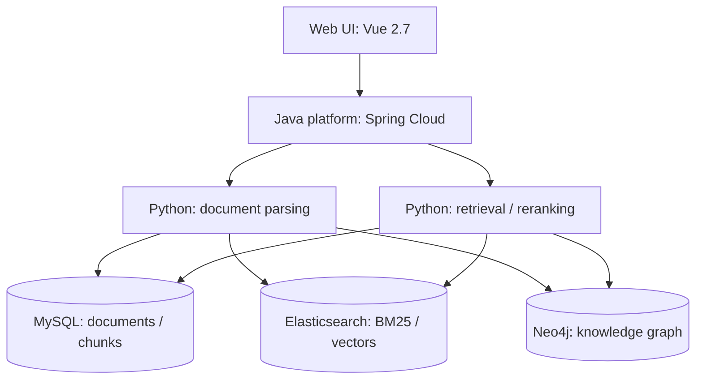

<div align="center">

# Enterprise Knowledge RAG

### Multimodal Document Understanding · GraphRAG · Hybrid Search · Evidence-grounded Q&A

**An enterprise knowledge-base platform connecting document parsing, structured knowledge extraction, graph retrieval, and traceable answers.**

[简体中文](README.zh-CN.md) · [Algorithms](docs/ALGORITHMS.md) · [Reproducibility](docs/REPRODUCIBILITY.md)


</div>

> **Project status:** This repository is a source snapshot of a platform integrated with existing enterprise infrastructure. It is **not yet a self-contained, one-command demo**. The Java service uses internal Maven dependencies, and some referenced local development scripts are absent from this snapshot. See [reproducibility and known gaps](docs/REPRODUCIBILITY.md) before attempting deployment.

## Why this project?

Many RAG examples demonstrate *PDF → embeddings → chatbot*. Enterprise documents create harder problems: page structure, tables and diagrams, domain entities and relationships, conflicting evidence, access control, and citations that users can verify.

Enterprise Knowledge RAG explores a more structured pipeline:

1. **Understand the document** using layout-aware OCR or a vision-language OCR backend.
2. **Preserve its structure** with catalog-, AST-, and container-aware chunking.
3. **Extract and connect knowledge** in a Neo4j graph.
4. **Retrieve across multiple channels** with query-aware routing, rank fusion, and reranking.
5. **Ground results in evidence** with text-span alignment and image/source references.

## Capabilities in the codebase

| Area | Implementation highlights | Source |
| --- | --- | --- |
| Multimodal parsing | PDF/image OCR via Paddle layout or Qianfan-compatible VLM; text/Markdown and DOCX extraction | [document_parser.py](python-service/src/danbao_poc/document_parser.py), [multimodal.py](python-service/src/danbao_poc/multimodal.py) |
| Structure-aware chunking | Catalog, AST, and container strategies; protected table and code blocks | [ast_chunker.py](python-service/src/danbao_poc/ast_chunker.py), [catalog_chunker.py](python-service/src/danbao_poc/catalog_chunker.py) |
| Knowledge graph | Entity/relationship extraction, deduplication candidates, community grouping, Neo4j indexing | [anchor_deduper.py](python-service/src/danbao_poc/anchor_deduper.py), [graph_community.py](python-service/src/danbao_poc/graph_community.py) |
| Hybrid retrieval | QA, structured data, section summary, graph, BM25, and vector channels; profile-aware retrieval planning | [query.py](python-service/src/danbao_poc/query.py), [retrieval_plan.py](python-service/src/danbao_poc/retrieval_plan.py) |
| Citation alignment | Exact, normalized, and LCS-based evidence alignment with coverage/density checks | [evidence_aligner.py](python-service/src/danbao_poc/evidence_aligner.py) |
| Platform features | Knowledge-base/file APIs, permissions, audit trails, parse task callbacks, QA management, graph UI | [Java service](java-service/app-knowledge-service/), [web UI](knowledge-web/src/views/knowledge/) |

These are **implementation features, not published benchmark claims**. Domain-profile support and end-to-end deployment have different maturity levels; see the linked module documentation.

## Architecture



Supporting infrastructure includes Redis, OCR/model endpoints, and an external file-center service.

## Screenshots

| Document parsing | Process-level multimodal evidence |
| --- | --- |
|  |  |
| Knowledge graph | Image evidence tracing |
|  |  |

## Repository layout

```text
python-service/   FastAPI-based parsing, indexing, retrieval, graph processing
java-service/     Spring Cloud knowledge-base platform and API contracts
knowledge-web/    Vue 2.7 + Vite 4 admin UI and graph visualization
assets/           Product screenshots
docs/             Algorithm map and reproducibility notes
```

### Technology

- **AI services:** Python 3.10, FastAPI, PyMuPDF, Paddle layout OCR, OpenAI-compatible model clients.
- **Search & storage:** Elasticsearch 7.x, Neo4j 5.x, MySQL, Redis.
- **Backend:** Java 8, Spring Cloud, MyBatis-Plus, Nacos and enterprise Maven components.
- **Frontend:** **Vue 2.7** (not Vue 3), Vite 4, Ant Design Vue 1.x, G6 4.x, Pinia.

## Getting started

There is **no verified standalone quick start** for the full stack in this public snapshot.

| Component | Prerequisites | Start here |
| --- | --- | --- |
| Python parsing/retrieval | Python 3.10 or Docker; provisioned MySQL, ES, Neo4j, Redis, file center, OCR/LLM endpoints | [Python README](python-service/README.md) |
| Java platform | Java 8, Maven, access to enterprise parent POM and `com.ludan` dependencies | [Java module](java-service/) |
| Web UI | Node 14.x and npm ≥ 8.3; restore missing build/environment script before installing | [Web README](knowledge-web/README.md) |

For exact blockers and a checklist of what needs to be supplied to make a reproducible community demo, read **[REPRODUCIBILITY.md](docs/REPRODUCIBILITY.md)**.

## Algorithm design and evaluation

The most useful entry point for technical readers is **[ALGORITHMS.md](docs/ALGORITHMS.md)**. It maps core techniques to source files, explains design trade-offs, and identifies measurements needed to substantiate effectiveness.

No Recall@k, MRR, accuracy, or latency improvement is claimed here without a published evaluation set and reproducible results.

## Roadmap

- [x] Multimodal parsing and structured chunk representation in code
- [x] Graph construction, hybrid retrieval, and evidence-alignment components
- [ ] Publish a license **after confirming ownership and redistribution rights**
- [ ] Provide a sanitized sample dataset and a dependency-light local demo
- [ ] Add automated tests, CI, and reproducible retrieval/citation benchmarks
- [ ] Verify a complete installation path independent of internal infrastructure
- [ ] Explore ColPali / VisRAG-style visual retrieval enhancements

## Important note on reuse

The repository currently has **no top-level open-source license**. Public visibility alone does not grant permission to redistribute or reuse the code. Any license should be chosen only after confirming the rights to the enterprise-related components and assets.

---

<div align="center">
Built for structured enterprise knowledge retrieval, multimodal evidence, and traceable answers.
</div>
