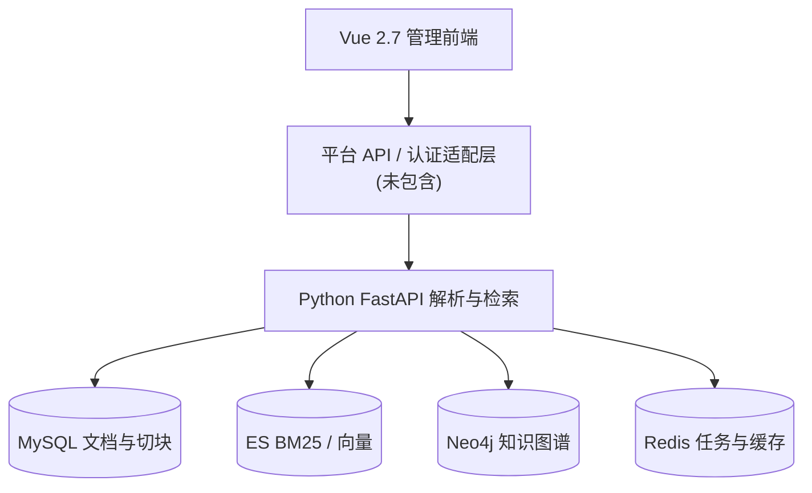
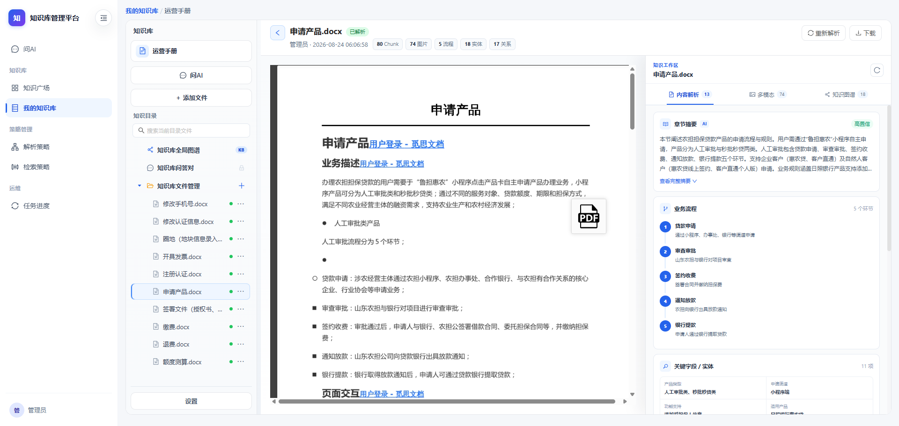
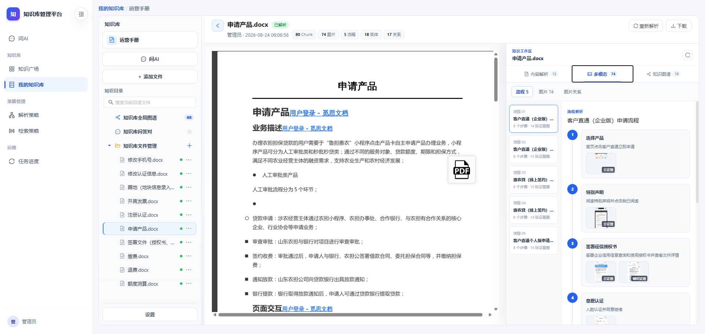
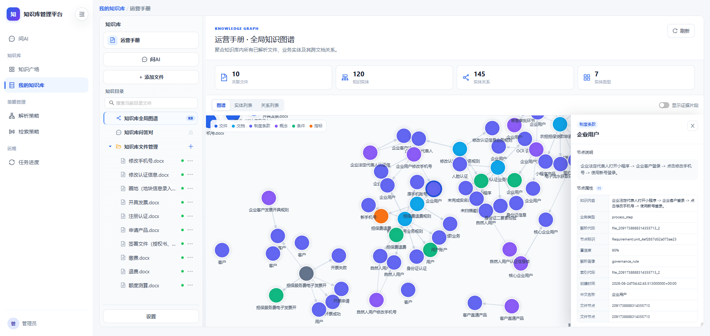
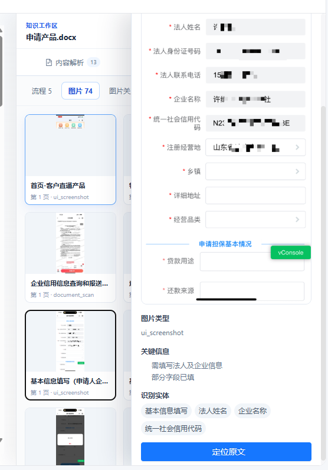

<div align="center">

# 🧠 Enterprise Knowledge RAG

### 多模态文档理解 · GraphRAG 知识图谱 · 混合检索 · 证据可溯源问答

**从文档结构解析，到知识关联，再到能够核对原文的检索结果。**

[English](README.md) · [算法说明](docs/ALGORITHMS.md) · [复现状态](docs/REPRODUCIBILITY.md) · [接口集成](docs/INTEGRATION.md)


</div>

> **项目状态：** 当前公开版保留 Python RAG 引擎与 Vue 知识库管理前端，原有企业 Java 业务实现因缺少再发布授权已从本次拟公开代码树中移除。项目仍依赖外部数据库、OCR/LLM 服务和文件中心；前端也需要独立的平台 API / 认证适配层，**暂不能视为一键部署 Demo**。参见 [复现说明](docs/REPRODUCIBILITY.md)。

## ✨ 核心能力

| 方向 | 实现与价值 | 源码 |
| --- | --- | --- |
| 多模态解析 | PDF、图片版面 OCR / VLM OCR，DOCX、文本解析与图片证据 | [解析模块](python-service/src/danbao_poc/document_parser.py) |
| 智能切块 | Catalog / AST / 容器策略，识别标题、条款、表格和代码块结构 | [AST 切块](python-service/src/danbao_poc/ast_chunker.py) |
| 知识图谱 | 实体关系抽取、归一化去重、社区发现、Neo4j 索引 | [实体去重](python-service/src/danbao_poc/anchor_deduper.py) · [社区发现](python-service/src/danbao_poc/graph_community.py) |
| 混合检索 | QA、结构化、章节摘要、图谱、BM25、向量等多通道；按文档类型和意图规划 | [检索策略](python-service/src/danbao_poc/retrieval_plan.py) |
| 证据溯源 | 精确匹配、归一化匹配和 LCS 证据对齐，支持来源位置记录 | [证据对齐](python-service/src/danbao_poc/evidence_aligner.py) |
| 界面管理 | 知识库、文件、Chunk、策略、图谱可视化等页面 | [前端页面](knowledge-web/src/views/knowledge/) |

这些是已发现的**源码实现能力**，不是经过公开 Benchmark 证明的准确率提升。不同业务 Profile 的端到端成熟度也可能不同。

## 🏗️ 系统架构



OCR / LLM 和文件中心也是外部依赖。可以按 [通用接口集成指南](docs/INTEGRATION.md) 设计自己的适配层。

## 📸 产品界面

| 文档解析 | 多模态流程证据 |
| --- | --- |
|  |  |
| 知识图谱 | 图片证据溯源 |
|  |  |

## 📦 代码结构

```text
python-service/    FastAPI 解析、切块、抽取、图谱、索引、检索
knowledge-web/     Vue 2.7 / Vite 4 / Ant Design Vue 1.x 管理前端
assets/            产品截图
docs/              算法、接口与复现文档
```

技术选型：

- **AI 引擎：** Python 3.10、FastAPI、PyMuPDF、Paddle / VLM OCR 接入
- **检索与存储：** Elasticsearch 7.x、Neo4j 5.x、MySQL、Redis
- **前端：** Vue **2.7**、Vite 4、Ant Design Vue 1.x、G6、Pinia

## 🚀 如何运行？

当前代码尚未形成完全独立、已验证的一键部署方案：

1. [Python 服务说明](python-service/README.md)：含解析、索引、检索 API；需要配置外部服务。
2. [前端说明](knowledge-web/README.md)：需要 Node 14.x、npm ≥ 8.3；当前仓库缺少其环境校验脚本。
3. [复现清单](docs/REPRODUCIBILITY.md)：列明缺失项及独立 Demo 所需工作。
4. [通用接口设计](docs/INTEGRATION.md)：帮助通过自建服务连接前端与 AI 引擎。

Python 服务已有 `POST /api/v1/parse/files`、`POST /api/v1/index/files`、`POST /api/v1/retrieve/query` 等接口，详细参数见服务文档。

## 🔬 算法与验证

请看 [ALGORITHMS.md](docs/ALGORITHMS.md)，其中逐一介绍切块、MinHash/LSH 实体去重、社区发现、检索路由与证据对齐，并给出可复现实验的建议。

后续重点：

- [ ] 去除外部私有依赖，提供可独立运行的最小 Demo
- [ ] 加入可公开分发的示例文档与问答集
- [ ] 添加 CI / 自动化测试、召回率和证据精度 Benchmark
- [ ] 评估 ColPali、VisRAG 等视觉检索增强
- [ ] 确认所有组件授权后添加合适的开源许可证

> 当前尚未选择顶层 LICENSE。公开可见不代表已授予自由复制、修改或商业使用的权利。

---

<div align="center">Enterprise Knowledge RAG · 从结构化知识到可追溯的答案</div>
